<div align="center">

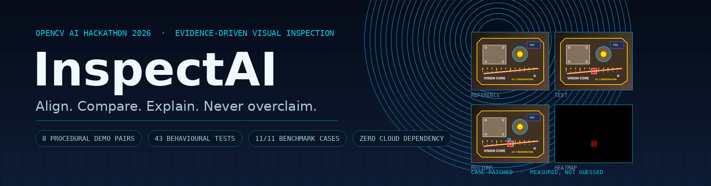

# InspectAI

**Evidence-driven visual inspection for image pairs.**<br>
Align the geometry. Measure the difference three ways. Record every decision. Never pretend to know what the defect is.

[](https://www.python.org/)
[](https://opencv.org/)
[](#tests-and-benchmarks)
[](#measured-evidence)
[](#json-evidence-report)
[](#limitations)

[**▶ Open the interactive demo**](https://nomee-123.github.io/InspectAI/) ·
[**Run the Streamlit app**](#run-the-streamlit-app) ·
[**Read a real report**](demo/evidence/perspective.json) ·
[**Browse the evidence**](demo/evidence/)

</div>

> [!IMPORTANT]
> **InspectAI measures change. It does not certify defects.**
>
> A change region is an image-difference measurement. Percentage differences,
> Canny agreement, SSIM, phase-correlation response and NCC gains are decision
> evidence, **not calibrated defect probabilities**. Real-world validation,
> domain thresholds and a qualified reviewer are still required before any
> maintenance or quality decision.
>
> This is a local, inspectable prototype: no cloud deployment, no database, no
> external model, and no hidden verdict.

---

## Contents

- [Why InspectAI](#why-inspectai)
- [The interactive demo](#the-interactive-demo)
- [Quickstart](#quickstart)
- [Run the Streamlit app](#run-the-streamlit-app)
- [How it works](#how-it-works)
- [The algorithms, diagrammed](#the-algorithms-diagrammed)
- [Measured evidence](#measured-evidence)
- [JSON evidence report](#json-evidence-report)
- [Demo gallery](#demo-gallery)
- [Repository layout](#repository-layout)
- [Core API](#core-api)
- [Tests and benchmarks](#tests-and-benchmarks)
- [Limitations](#limitations)
- [Contributing](#contributing)
- [Credits and licensing](#credits-and-licensing)

---

## Why InspectAI

Most image-difference demos subtract two pictures and paint the result red. That
works until the camera moved two pixels, the part was rotated, or the exposure
changed. InspectAI treats comparison as an **audit trail**, not a single score.

| Principle | What it means in practice |
| --- | --- |
| **Align before comparing** | Quarter-turn orientation, phase correlation, SIFT + RANSAC, ECC refinement, and a log-polar fallback are tried in order of increasing complexity. |
| **Ambiguity is a result** | Repetitive grids, symmetric parts, and weak phase peaks are reported as **ambiguous**. No rotation or translation is silently chosen. |
| **Three methods, no secret average** | CIE-Lab ΔE, Canny edge agreement, and a local SSIM implementation are reported side by side. When they disagree, the disagreement stays visible. |
| **Every step is auditable** | Each candidate keeps its matrix, status, metrics, reason, and preview. Rejected and ambiguous steps remain in the UI and the JSON report. |
| **No pixels in the report** | The schema-v2 JSON contains measurements and metadata only. Image data stays local. |
| **Same core everywhere** | The `inspectai` package never imports Streamlit. The demo builder, tests, and Streamlit UI all call the same pipeline; the static demo replays its measured output. |

### What it is not

- Not a defect detector and not an anomaly classifier.
- Not a calibrated probability model.
- Not a cloud service, database, or multi-tenant product.
- Not a substitute for a qualified visual inspection process.

---

## The interactive demo

<p align="center">
  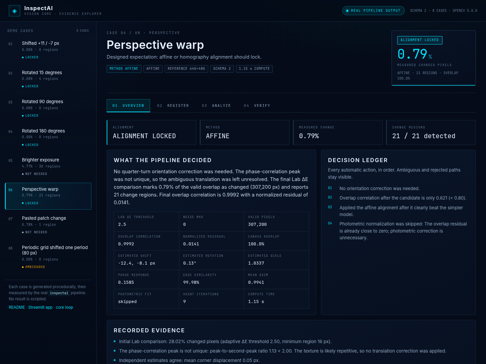
</p>

<p align="center"><sub><strong>Real output, replayed.</strong> Case 06 — perspective warp: alignment locked with an affine model, 0.79% measured change, 21 change regions. Every number was produced by the pipeline; nothing is scripted.</sub></p>

The repository ships a **zero-dependency static demo MVP** in [`demo/`](demo/).
It replays the real output of the `inspectai` pipeline for all eight procedural
sample pairs:

- **OVERVIEW** — verdict badge, measured change, region counts, decision ledger, and the evidence lines from the report.
- **REGISTER** — the full alignment ladder: step rail, recorded previews, matrix, keypoints, rejection reasons, and a play/scrub control.
- **ANALYZE** — interactive reference/aligned wipe, Lab ΔE heatmap, change mask, and clickable change-region boxes with measured bounds.
- **VERIFY** — Lab ΔE / Canny / SSIM method cards, disagreement alert, agent trace, uncertainty warnings, limitations, function trace, and JSON download.

Deep links encode the current view, for example:

```text
demo/index.html?case=perspective&tab=register&step=4
demo/index.html?case=patched&tab=analyze&layer=regions&wipe=46
```

The page uses only `index.html`, `styles.css`, `app.js`, and `data.js`. It works
from `file://` because the payload is loaded with a plain `<script>` tag instead
of `fetch`. It also respects `prefers-reduced-motion` and keyboard navigation.

### Build, verify, and serve the demo

```bash
# Rebuild every artifact from the real pipeline, then verify 17 designed behaviours
python demo/build_demo.py --check

# Build and serve at http://127.0.0.1:8000
python demo/build_demo.py --serve

# Serve the already-committed artifacts without rebuilding
python demo/build_demo.py --serve --no-build
```

`demo/build_demo.py` runs `inspect_images` and `build_inspection_report` over
every pair in [`samples/manifest.json`](samples/manifest.json). It writes:

```text
demo/data.js                  compact replay payload for the browser
demo/evidence/*.json          full schema-v2 report per case
demo/evidence/index.json      measured summary table
demo/assets/cases/<id>/       reference, test, aligned, heatmap, mask, regions,
                              panel, and per-step previews
demo/assets/banner.png        README banner composed from real result pixels
```

> [!NOTE]
> The committed `demo/data.js` and `demo/assets/cases/` are generated files.
> Never hand-edit them. Run `python demo/build_demo.py` after changing the
> pipeline, samples, or report schema.

### Deploy the demo

[`.github/workflows/pages.yml`](.github/workflows/pages.yml) publishes the
contents of `demo/` to GitHub Pages on pushes to `main`. Enable **Settings →
Pages → Source: GitHub Actions** once, then the demo is available at:

**https://nomee-123.github.io/InspectAI/**

If Pages is not enabled on your fork, the local serve command above behaves
identically.

---

## Quickstart

### 1. Clone and install

```bash
git clone https://github.com/Nomee-123/InspectAI.git
cd InspectAI

python3 -m venv .venv
source .venv/bin/activate            # Windows: .\.venv\Scripts\Activate.ps1
python -m pip install --upgrade pip
python -m pip install -r requirements.txt
```

Requires **Python 3.10+**, **NumPy 2.x**, **OpenCV 5.x**, and **Streamlit 1.66+**.
The inspection core needs only NumPy and OpenCV; Streamlit is the UI layer.
Pillow is used by the demo builder (and is already installed by Streamlit).

### 2. Open the demo

```bash
python demo/build_demo.py --check --serve
# → http://127.0.0.1:8000
```

Or simply open [`demo/index.html`](demo/index.html) in a browser — the committed
payload works without a server.

### 3. Run the Streamlit app

```bash
python -m streamlit run app.py
```

Streamlit prints a local URL, usually `http://localhost:8501`.

---

## Run the Streamlit app

The Streamlit surface is the live **VISION CORE** console. It is a thin shell
around `inspectai` (pipeline) and `ui` (presentation).

1. Upload a reference image and a test image, or load a generated demo pair from
   the sidebar. Uploads take precedence over a loaded pair.
2. Enable center-cropped copies only when the frame shapes are unrelated. A
   90°/270° pair already has reciprocal aspect ratios, so orientation handles it
   without cropping.
3. Select **Run inspection**.
4. Review the three result tabs:
   - **REGISTER** — step timeline, Prev/Next/Play, scrubber, lock-on markers,
     blend/checker/difference/edge/A-B/swipe overlays, an OpenCV preview toggle,
     LOCKED / AMBIGUOUS / REJECTED / NO ALIGNMENT badges, metrics, reasons and a
     residual chart.
   - **ANALYZE** — reference, aligned test, difference heatmap, change mask,
     interactive change-region boxes, region tags and the reference/aligned wipe.
   - **VERIFY** — per-method indications (Lab ΔE, Canny, SSIM), the agent feed,
     evidence lines, decisions, uncertainty warnings, limitations, the function
     trace, the JSON preview and a download button.
5. Use **Reduce motion** in the sidebar to stop ambient CSS animation, particles,
   boot playback, registration playback and gauge count-up. The **LIMITATIONS**
   expander is always available.

Interactive widgets are sandboxed HTML/JS iframes created with `st.iframe`;
ambient CSS lives in `ui/theme.py`. Motion and accessibility evidence is recorded
in [`ui_checklist.md`](ui_checklist.md).

### Demo pairs

[`samples/make_samples.py`](samples/make_samples.py) writes deterministic,
procedural PNG pairs plus [`samples/manifest.json`](samples/manifest.json):
translation, 15°/90°/180° rotation, brighter exposure, perspective warp, a pasted
patch, and a periodic grid shifted by exactly one period.

No sample result is scripted. The grid pair is designed to remain **alignment
ambiguous**; the pipeline proves it at runtime.

---

## How it works

### System mind map

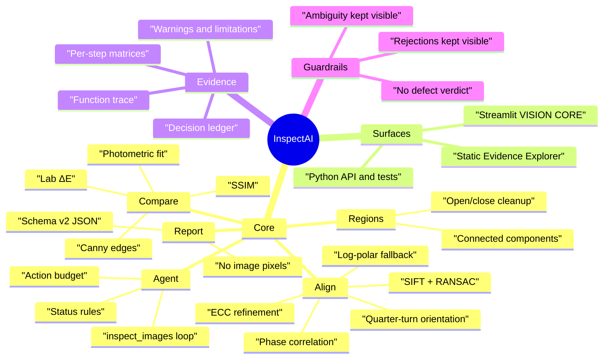

### Architecture

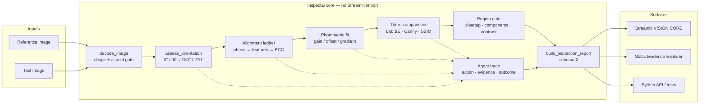

The core is deliberately Streamlit-free. `app.py` and `ui/` only format and
display what `inspectai` measured. The static demo follows the same rule: it
replays generated evidence and never computes its own measurements.

### Request and evidence flow

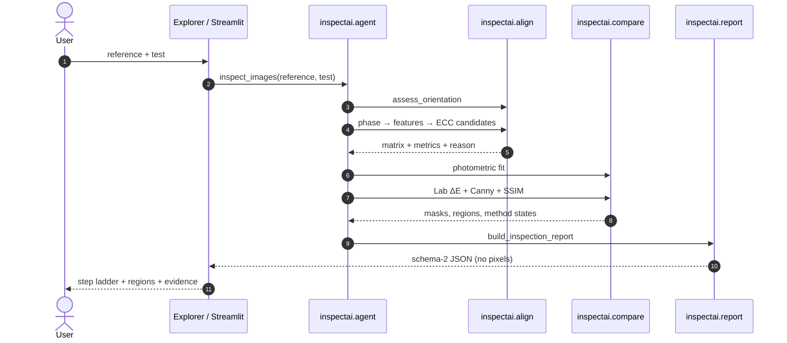

### Pipeline state

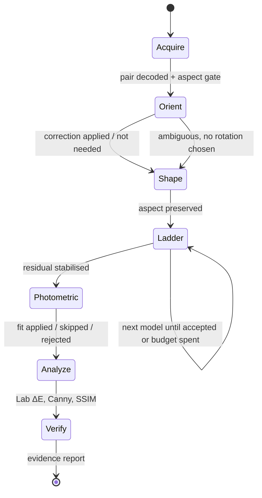

### Status vocabulary

| Status | Meaning |
| --- | --- |
| **applied** | A transform or normalization was applied: orientation, translation, similarity, affine, homography, or photometry. |
| **not_needed** | The evidence did not justify a correction. Comparison still runs on the pair. |
| **ambiguous** | The evidence was not decisive. No correction was silently chosen; candidates remain visible. |
| **rejected** | A candidate was tried and failed the acceptance gates. Its matrix and reason remain in the report. |

The UI never says “defect detected” or “anomaly confirmed”. It reports
**change regions**, **method disagreement**, and **alignment status**.

---

## The algorithms, diagrammed

### 1. Quarter-turn orientation

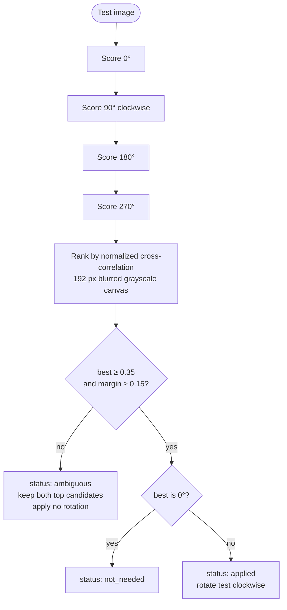

Mirrors are intentionally **not** tried: a mirrored image is a real change, not a
harmless orientation difference. Arbitrary angles (for example 15°) are handled
later by the feature ladder; if the quarter-turn score is weak, the orientation
step stays ambiguous instead of guessing.

### 2. The alignment ladder

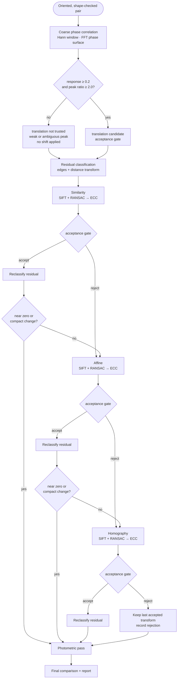

Every accepted candidate is applied cumulatively, then the final image is rebuilt
from the original test with a **single** cumulative warp so interpolation blur
does not accumulate.

### 3. Acceptance gates

A more complex model must clearly beat the current alignment. This is the part
that prevents the ladder from “improving” a good result into a worse one.

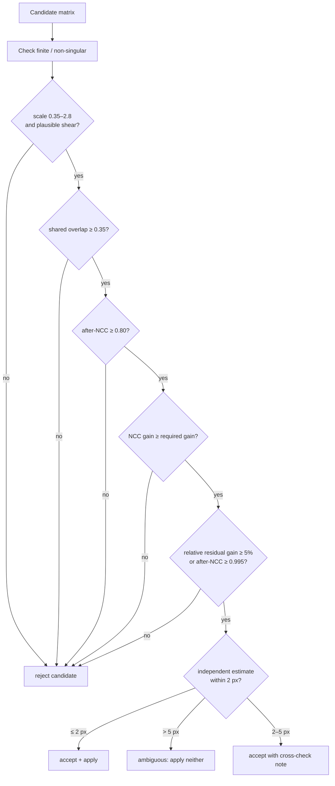

| Gate | Rule |
| --- | --- |
| Orientation | best NCC ≥ **0.35** and margin ≥ **0.15**; otherwise ambiguous |
| Texture | grayscale std ≥ **1.0**, minimum dimension ≥ **16 px** |
| Phase correlation | response ≥ **0.2**, peak ratio ≥ **2.0** |
| Feature matching | SIFT + RANSAC; ≥ **8** inliers, inlier ratio ≥ **0.35**, convex-hull spread ≥ **0.12** |
| Transform plausibility | scale **0.35–2.8**, similarity shear ≤ **0.08**, affine/translation shear ≤ **0.75**, overlap ≥ **0.35** |
| Candidate acceptance | after-NCC ≥ **0.80**; NCC gain ≥ `min(0.015 + 0.01·complexity, max(0.0005, 0.25·(1−before_NCC)))`; relative residual gain ≥ **5%** unless after-NCC ≥ **0.995** |
| Cross-check | independent estimates agree at ≤ **2 px**; diverge at > **5 px** |
| Photometric | relative residual improvement ≥ **8%** |
| Lab ΔE | adaptive threshold `max(2.5, 3.5 × MAD)` |
| Region gate | component area ≥ `max(16, round(valid_pixels × 0.00002))` and mean contrast ≥ `max(6, 1.5 × ΔE threshold)`; region indication also needs the largest region ≥ **0.05%** of valid pixels with contrast ≥ `max(8, 2.5 × ΔE threshold)` |
| Canny | automatic thresholds; **2 px** tolerance; disagreement ≥ **10%** |
| SSIM | 11×11 Gaussian, σ = **1.5**; local similarity < **0.7** |
| Agent budget | `DEFAULT_MAX_ACTIONS = 10`; the report's `action_budget` records actions actually used |

### 4. Photometric normalization

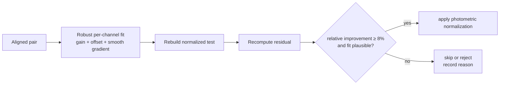

Photometric normalization is considered **before** the final difference. It is
rejected when implausible, and the normalized image plus residual stay visible
because a real change can resemble a smooth lighting gradient.

### 5. Comparison and region localization

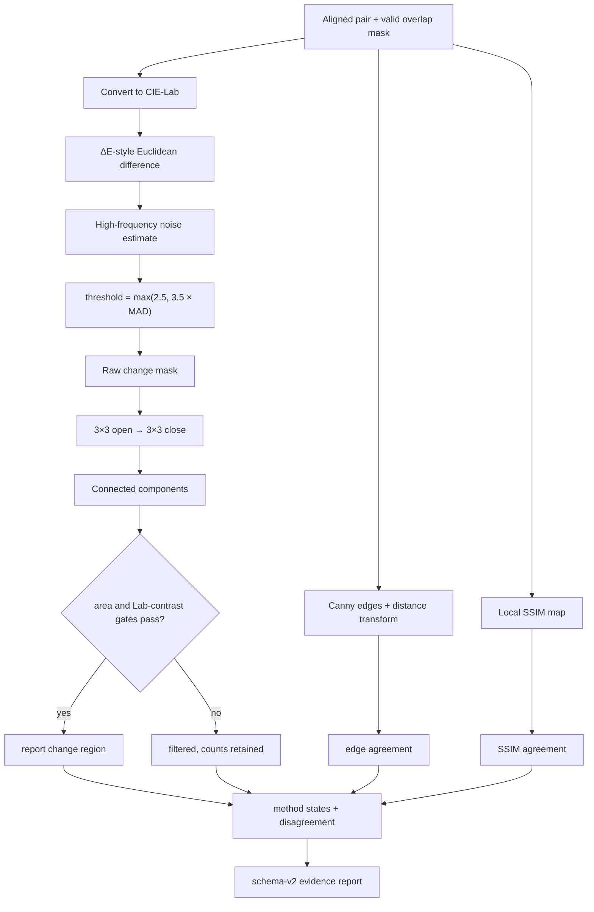

The three methods are **never averaged into one score**. SSIM is reported
separately. A change indication is region-aware, so a compact, high-contrast
change is not hidden by a global percentage rule.

### 6. The agent loop

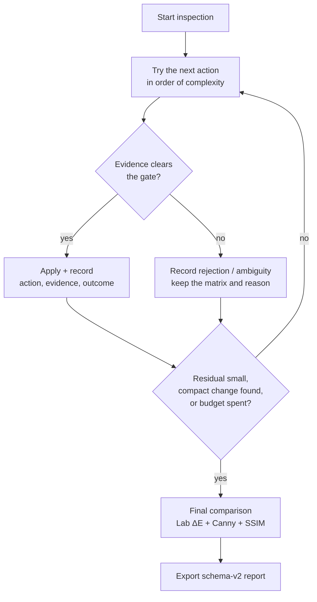

Every iteration has `{action, evidence, outcome, uncertainty}`. Progress events
are observational only: a callback can stream stage telemetry, but it cannot
change the result.

---

## Measured evidence

### Demo outcomes (8 procedural pairs)

Generated by `python demo/build_demo.py --check` on 2026-10-26 with Python 3.14.4,
OpenCV 5.0.0, and NumPy 2.5.4. All **17 behavioural demo assertions** passed.
Times are wall-clock compute for the pipeline on the build machine.

| Case | Status | Method | Initial % | Final % | Regions | Steps | Agent iters | Time |
| --- | --- | --- | ---: | ---: | ---: | ---: | ---: | ---: |
| Shifted +11 / −7 px | applied | translation | 29.15 | 0.00 | 0 | 5 | 5 | 0.58 s |
| Rotated 15° | applied | similarity | 52.98 | 0.08 | 4 | 9 | 11 | 1.79 s |
| Rotated 90° | applied | orientation | 0.00 | 0.00 | 0 | 6 | 5 | 0.29 s |
| Rotated 180° | applied | orientation | 0.00 | 0.00 | 0 | 6 | 5 | 0.30 s |
| Brighter exposure | not_needed | photometric | 100.00 | 4.77 | 30 | 5 | 5 | 0.45 s |
| Perspective warp | applied | affine | 28.02 | 0.79 | 21 | 7 | 9 | 1.15 s |
| Pasted patch change | not_needed | none | 0.78 | 0.78 | 1 | 8 | 11 | 0.98 s |
| Periodic grid, one-period shift | ambiguous | none | 0.00 | 0.00 | 0 | 6 | 5 | 0.44 s |

**Initial %** is measured after the orientation and shape gate, before the
alignment ladder. It is not a “raw pixel diff” of the un-oriented pair.

Two rows are deliberately instructive:

- **Rotated 15°** — quarter-turn scoring is ambiguous (best 0.332 < 0.35), so no
  rotation is chosen; the similarity model locks later. The ambiguity stays in
  the step list.
- **Pasted patch** — the ladder rejects similarity, affine and homography because
  their correlation gain is 0.000, below the 0.004 minimum. Alignment is
  `not_needed`; the single 2,408 px change region survives the gate.

### Benchmark (11 synthetic behavioural cases)

```text
$ python benchmarks/run_benchmark.py
case                           result status     method                       initial %  final % regions  seconds
-----------------------------------------------------------------------------------------------------------------
identical                      PASS   not_needed none                             0.000    0.000       0     0.29
translation                    PASS   applied    translation                      8.223    0.000       0     0.13
rotation_5deg                  PASS   applied    similarity                       7.065    0.000       0     0.18
rotation_45deg                 PASS   applied    similarity                      31.172    0.000       0     0.23
combined_rotation_scale_shift  PASS   applied    affine                          24.434    0.234       4     0.34
perspective                    PASS   applied    similarity+affine+homography    15.415    0.117       1     0.20
patch_only                     PASS   not_needed none                             2.112    2.112       1     0.22
lighting_gradient              PASS   not_needed photometric                     96.422    0.647       2     0.32
colour_only                    PASS   not_needed photometric                     98.841    2.231       5     0.18
repetitive_grid                PASS   ambiguous  none                           100.000  100.000       1     0.19
blank                          PASS   ambiguous  none                             0.000    0.000       0     0.04

Summary: 11/11 cases passed in 2.32s (numpy 2.5.4, OpenCV 5.0.0)
```

> [!WARNING]
> The benchmark is a **behavioural regression tool on deterministic synthetic
> images**, not a real-world accuracy measurement. Do not present these scores as
> inspection accuracy or defect-detection performance.

### Reproduce

```bash
python -m unittest discover -s tests -q       # 43 tests
python benchmarks/run_benchmark.py            # 11/11 behavioural cases
python demo/build_demo.py --check             # 8 real demo runs + 17 assertions
```

---

## JSON evidence report

Every run can produce a schema-v2 report. [Real example →](demo/evidence/perspective.json)

```json
{
  "schema_version": 2,
  "generated_at_utc": "2026-10-26T16:30:29+00:00",
  "images": {
    "reference_dimensions": { "width": 640, "height": 480 },
    "test_dimensions": { "width": 640, "height": 480 },
    "contents_included": false
  },
  "thresholds": {
    "lab_delta_final": 2.5,
    "phase_correlation_minimum_response": 0.2,
    "minimum_alignment_ncc": 0.8,
    "minimum_overlap_fraction": 0.35,
    "photometric_minimum_relative_improvement": 0.08,
    "action_budget": 8
  },
  "alignment": {
    "method": "affine",
    "status": "applied",
    "applied": true,
    "confidence": "cross_checked",
    "estimated_shift_pixels": { "x": -12.39, "y": -8.05 },
    "estimated_rotation_degrees": 0.13,
    "estimated_scale": 1.0337,
    "response": 0.1585,
    "overlap_fraction": 1.0
  },
  "measurements": {
    "pixel_difference": {
      "initial_changed_percentage": 28.0166,
      "final_changed_percentage": 0.7894,
      "final_changed_pixel_count": 2425,
      "valid_pixels": 307200,
      "region_indicated": true,
      "global_percentage_indicated": false
    },
    "changed_regions": {
      "region_count": 21,
      "detected_region_count": 21,
      "minimum_area_pixels": 16,
      "regions": [
        { "x": 362, "y": 435, "width": 185, "height": 3, "area_pixels": 555 }
      ]
    },
    "method_states": {
      "lab_difference_change_indicated": true,
      "canny_change_indicated": false,
      "ssim_change_indicated": true
    },
    "methods_disagree": true,
    "indication_agreement": "pixel_only_indicates_change"
  },
  "alignment_steps": ["…matrix, status, reason, metrics, keypoints…"],
  "agent": { "iterations": ["…action, evidence, outcome, uncertainty…"], "iteration_count": 9 },
  "function_trace": [{ "stage": "decode", "functions": ["cv2.imdecode"] }],
  "warnings": ["…uncertainty warnings…"],
  "limitations": ["…scope limits…"]
}
```

The report contains **no image pixels**. It is evidence metadata, not a
self-contained image archive. JSON is safe to serialize with
`json.dumps(..., allow_nan=False)`.

Top-level sections: `images`, `thresholds`, `measurements`, `alignment`,
`alignment_steps`, `agent`, `function_trace`, `selected_actions`, `evidence`,
`warnings`, `limitations`.

---

## Demo gallery

| REGISTER — alignment ladder | ANALYZE — regions and wipe |
| :---: | :---: |
| 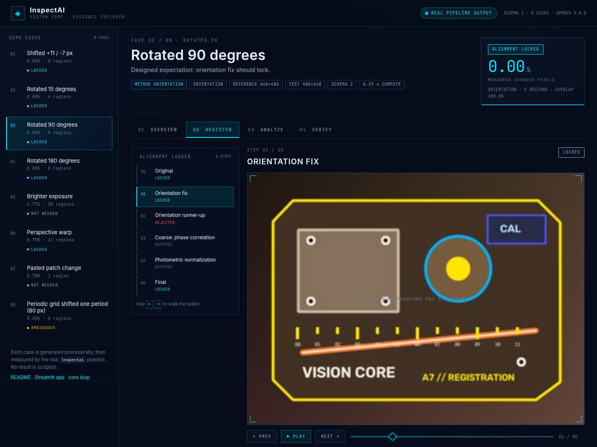 | 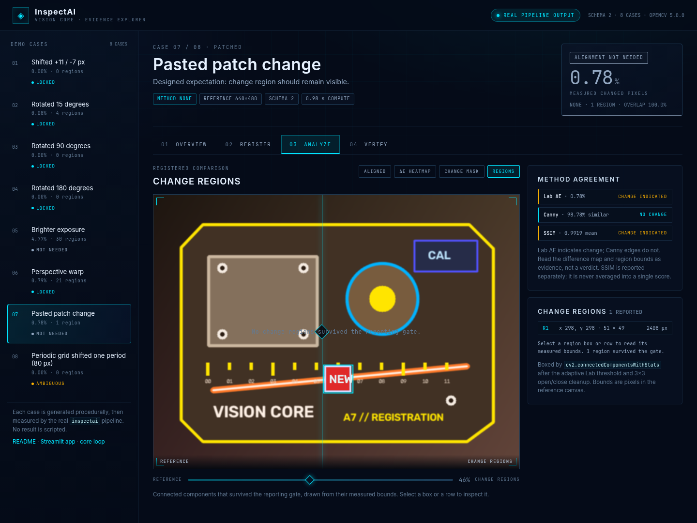 |
| 90° case: the pipeline applies a **270° clockwise** correction before shape checks. Step 0 is the original; the runner-up candidate stays visible. | Pasted patch: **0.78%** measured change, **1** region, box at x 298, y 298, 51 × 49 px. |

| VERIFY — method disagreement | Mobile — 390 × 844 |
| :---: | :---: |
| 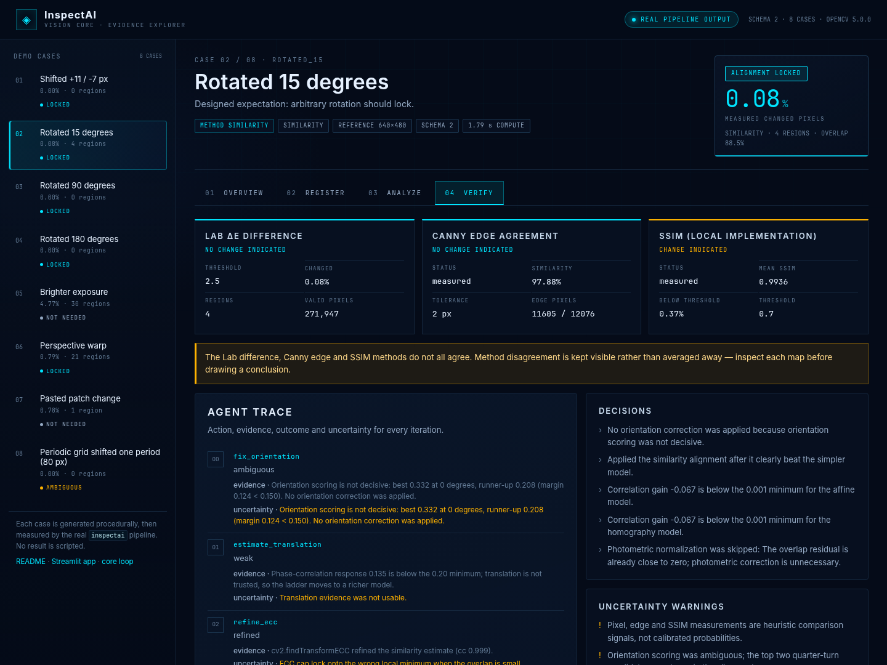 | 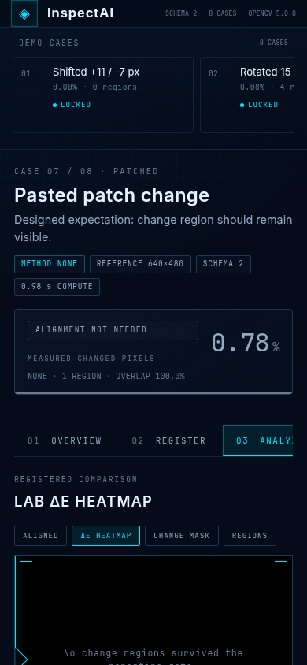 |
| 15° case: quarter-turn scoring is ambiguous; similarity locks. Lab ΔE, Canny and SSIM do **not** all agree, and the alert says so. | The same evidence, reflowed for a phone: case rail, tabs, stage, wipe, and region controls remain usable. |

Screenshots are captured from the static demo at 1440 × 1080 (desktop) and
390 × 844 (mobile). Image paths live under `demo/assets/screenshots/`.

---

## Repository layout

```text
app.py                          Thin Streamlit shell: inputs, run control, tabs
inspectai/                      Streamlit-free inspection core
  agent.py                      Loop, status decisions, evidence, agent trace
  align.py                      Orientation and alignment ladder
  compare.py                    Lab ΔE, Canny, SSIM, photometric fit
  regions.py                    Mask cleanup and component localization
  report.py                     JSON schema version 2
  types.py                      Dataclasses and transform convention
ui/
  theme.py                      Ambient VISION CORE CSS, focus rings, breakpoints
  components.py                 Hero, pipeline, gauges, panels, REGISTER, report
  pipeline.py                   Cached display payload and demo loading
  templates/                    HTML/JS widgets embedded with st.iframe
demo/                           Inbuilt zero-dependency demo MVP
  index.html                    Evidence Explorer shell
  styles.css                    Responsive dark VISION CORE layout
  app.js                        Replay logic: tabs, wipes, boxes, traces
  data.js                       Generated replay payload (do not edit)
  build_demo.py                 Real-pipeline build, checks, and local server
  evidence/                     Full schema-v2 reports + summary index
  assets/                       Banner, screenshots, case images, step previews
samples/make_samples.py         Deterministic procedural pair generator
samples/manifest.json           Eight designed pairs and expectations
tests/                          Unit and behavioural regression tests
benchmarks/run_benchmark.py     Deterministic synthetic benchmark
assets/README.md                User-supplied OpenCV logo instructions
ui_checklist.md                 Motion/accessibility checklist with file:line
.github/workflows/pages.yml     Publishes demo/ to GitHub Pages
```

---

## Core API

```python
from inspectai import build_inspection_report, decode_image, inspect_images

reference = decode_image(reference_bytes)
test = decode_image(test_bytes)

result = inspect_images(reference, test)
report = build_inspection_report(reference, test, result)
```

`result` contains the comparisons, alignment steps, agent trace, function trace,
final matrix, and the aligned images needed by a UI. The JSON report is safe to
serialize and excludes image contents.

For a progress stream (observational only):

```python
def on_progress(stage: str, detail: dict) -> None:
    print(stage, detail["phase"], detail.get("status", ""))

result = inspect_images(reference, test, progress_callback=on_progress)
```

Public exports include `inspect_images`, `build_inspection_report`,
`decode_image`, `center_crop_pair`, `assess_orientation`, `phase_correlation`,
`score_alignment`, `compare_images`, `compare_edges`, `compare_ssim`,
`fit_photometric_normalization`, `detect_changed_regions`, `warp_image`,
`warp_mask`, `DEFAULT_MAX_ACTIONS`, and `LIMITATIONS`.

---

## Tests and benchmarks

```bash
# Unit + behavioural suite
python -m unittest discover -s tests -v

# Same suite, quiet
python -m unittest discover -s tests -q

# Synthetic benchmark with pass/fail gates
python benchmarks/run_benchmark.py
python benchmarks/run_benchmark.py --verbose
python benchmarks/run_benchmark.py --json /tmp/inspectai-benchmark.json
```

The **43 tests** cover legacy compatibility plus the evidence-agent behaviours:
rotation and 45° alignment, combined rotation/scale/shift, perspective warps,
patch-only change localization, lighting normalization, colour-only change,
repetitive-texture ambiguity, blank inputs, method disagreement, schema 2,
progress-event ordering, JSON-safe alignment steps without image data, required
agent-trace fields, function tracing, generated samples, and forbidden UI wording.

The **11 benchmark cases** are deterministic synthetic regressions. They prove
behaviour, not real-world accuracy.

---

## Limitations

- **No defect verdict.** A change region is an image-difference measurement.
  Real-world validation, domain thresholds and a qualified reviewer are required
  before any maintenance or quality decision.
- **No calibrated confidence.** Phase-correlation response, NCC gains and
  percentage differences are decision evidence, not probabilities.
- **Repetitive textures and symmetric parts** can make alignment ambiguous.
  InspectAI flags this instead of silently correcting it.
- **Photometric normalization can absorb a real change** that resembles a smooth
  lighting gradient. Review the photometric residual and the normalized image,
  not only the final percentage.
- **Global transforms only.** The ladder handles translation, similarity, affine
  and perspective changes. It does not model non-rigid deformation.
- **Resizing, cropping, interpolation, focus, compression and sensor noise** can
  create or hide differences.
- **SSIM is sensitive to resampling edges.** A near-perfect alignment can still
  produce a small number of low-SSIM pixels, so SSIM may indicate change while
  Lab ΔE and Canny do not. That disagreement is reported, not suppressed.
- **The report excludes image pixels.** It is evidence metadata, not a
  self-contained image archive.
- **Local only.** No AWS deployment, authentication, persistence or multi-tenant
  service is included in this pass.
- **The benchmark is synthetic.** It is not an accuracy claim.

---

## Contributing

Issues and pull requests are welcome. Keep the evidence-first contract intact:

1. **Never script a result.** Every displayed number must come from
   `inspect_images` or `build_inspection_report`.
2. **Keep ambiguity visible.** Do not replace an ambiguous status with a guess.
3. **Keep rejections auditable.** Rejected steps retain their matrix, metrics and
   reason.
4. **Do not average methods into a verdict.** Report disagreement explicitly.
5. **Don’t add a cloud or model dependency** without a clear design discussion.

Before opening a pull request:

```bash
python -m unittest discover -s tests -q
python benchmarks/run_benchmark.py
python demo/build_demo.py --check
```

If you change the pipeline, samples, thresholds, or report schema, rebuild the
demo and include the regenerated evidence in the same pull request. Do not edit
`demo/data.js` by hand.

---

## Credits and licensing

Built for the **OpenCV AI Hackathon 2026** with Python, OpenCV, NumPy and
Streamlit. The procedural sample generator and benchmark use only synthetic
imagery — no copyrighted photographs are bundled.

The header expects a **user-supplied** OpenCV logo at `assets/opencv_logo.png`.
InspectAI does not draw, trace, regenerate or hotlink the OpenCV logo. If the file
is absent, the header falls back to a text badge and prints a one-time warning;
see [`assets/README.md`](assets/README.md). Only add the logo if you have the
right to use it.

**No license file is included in this repository.** Add a license before
redistributing or using the code commercially.
